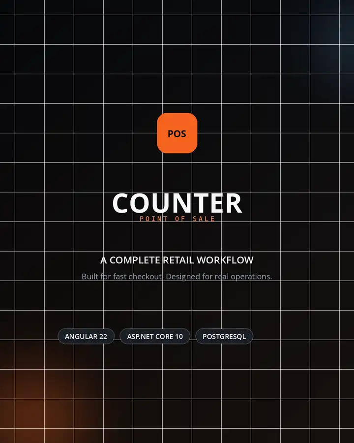
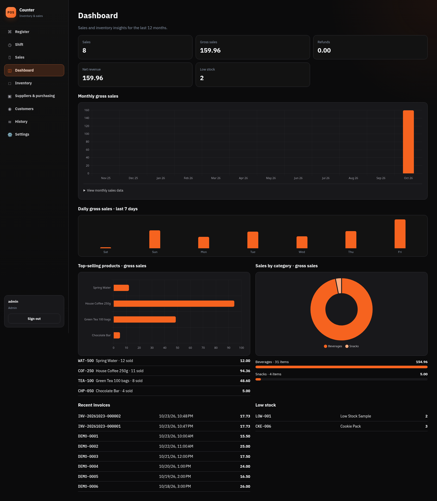
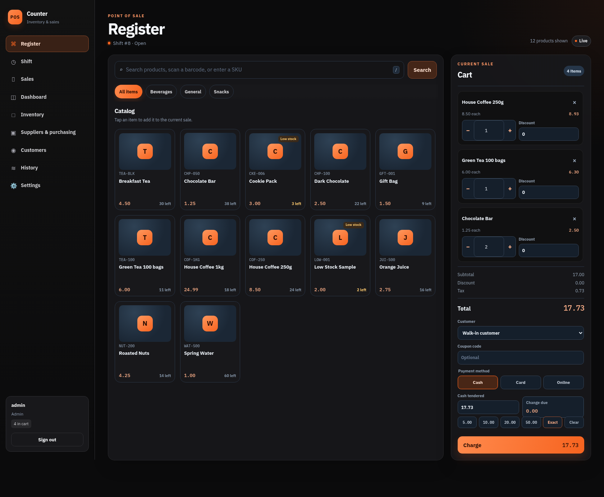
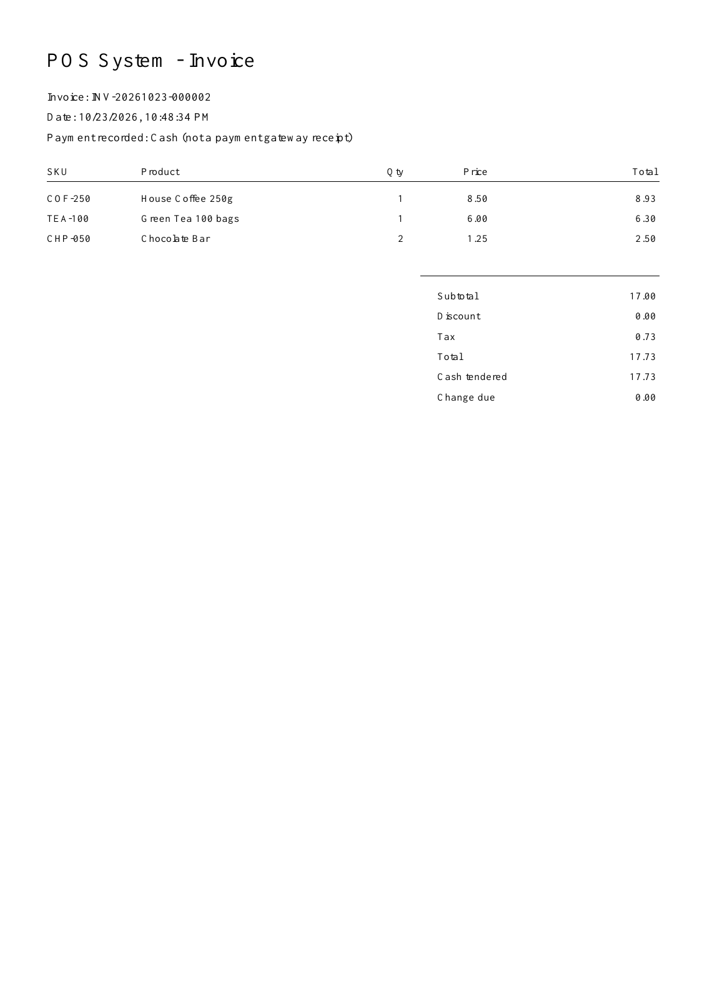
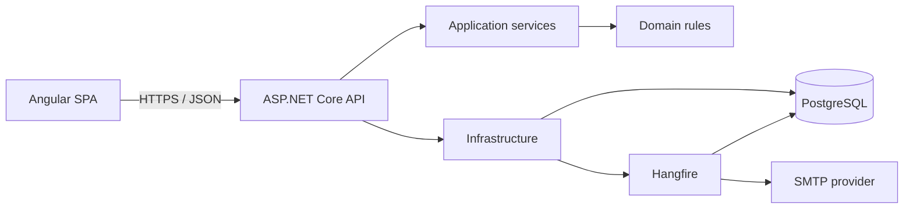

<div align="center">

# CounterPOS

Point-of-sale and retail management system built with Angular, ASP.NET Core, and PostgreSQL.

[](https://github.com/ahmadislam/CounterPOS/actions/workflows/ci-cd.yml)


[Live demo](https://possystem-1-26mq.onrender.com) ·
[Swagger](https://possystem-1-26mq.onrender.com/swagger/index.html) ·
[API specification](https://possystem-1-26mq.onrender.com/swagger/v1/swagger.json)

**Select “Explore live demo” to enter without a password.**

</div>

CounterPOS is a point-of-sale and retail management application for processing sales, managing inventory and purchasing, tracking cashier shifts, and reviewing store performance. The system includes an Angular frontend, an ASP.NET Core API, PostgreSQL persistence, scheduled jobs, downloadable reports, and automated tests.

The public demo contains sample data. Configuration pages can be viewed, but sensitive administrative actions are disabled to keep the shared environment stable. Free Render services may take a few seconds to wake up.

## Demo

<p align="center">
  <a href="https://raw.githubusercontent.com/ahmadislam/CounterPOS/main/docs/media/CounterPOS-Demo.mp4">
    
  </a>
</p>

<p align="center">
  <a href="https://raw.githubusercontent.com/ahmadislam/CounterPOS/main/docs/media/CounterPOS-Demo.mp4"><strong>Watch the 36-second walkthrough</strong></a>
</p>



<table>
  <tr>
    <td width="60%"></td>
    <td width="40%"></td>
  </tr>
  <tr>
    <td align="center">Register and checkout</td>
    <td align="center">PDF invoice</td>
  </tr>
</table>

## Features

- Product search, SKU scanning, category filters, discounts, coupons, tax, and customer loyalty
- Cash, Card, and Online payment records with cash tender and change calculation
- Cashier shift opening, closing, expected cash, and variance reconciliation
- Inventory, categories, suppliers, stock adjustments, product images, and low-stock thresholds
- Purchase orders with Draft, Ordered, Received, and Cancelled states
- Customer profiles, loyalty balances, and return-aware loyalty history
- Partial returns, refund records, automatic restocking, and return reasons
- Revenue, product, and category charts powered by server-side aggregates
- Excel sales and inventory reports plus downloadable PDF invoices
- Email alerts and scheduled summaries through Hangfire and MailKit
- Admin, Manager, and Cashier permissions with staff account management
- Soft deletion, audit history, refresh-token rotation, and login throttling

Card and Online are recorded payment methods; this project does not process real gateway transactions.

## Stack

| Area | Technology |
|---|---|
| Frontend | Angular 22, TypeScript, RxJS, Chart.js, jsPDF |
| API | .NET 10, ASP.NET Core, JWT authentication |
| Data | PostgreSQL 16, Entity Framework Core |
| Jobs and email | Hangfire, MailKit SMTP |
| Reports | ClosedXML and jsPDF |
| Tests | xUnit, Vitest, PostgreSQL integration tests, Playwright |
| Delivery | Docker, GitHub Actions, Render, Neon |

## Architecture



The backend follows a Clean Architecture layout:

- `PosSystem.Domain` — entities, enums, pricing, discount, and return rules
- `PosSystem.Application` — services, DTOs, authorization rules, and abstractions
- `PosSystem.Infrastructure` — EF Core, PostgreSQL, JWT, reports, email, and jobs
- `PosSystem.Api` — controllers, middleware, health checks, and application startup
- `web` — Angular interface and browser tests

Checkout, returns, purchasing, stock movements, loyalty entries, and audit records use database transactions. Product updates use PostgreSQL concurrency tokens, while checkout requests use an idempotency key to avoid duplicate sales.

The full ERD and workflow diagrams are in [docs/architecture.md](docs/architecture.md).

## Project layout

```text
CounterPOS/
├── src/
│   ├── PosSystem.Domain/
│   ├── PosSystem.Application/
│   ├── PosSystem.Infrastructure/
│   └── PosSystem.Api/
├── web/                 # Angular application
├── tests/               # Unit and integration tests
├── docs/                # API, architecture, and deployment notes
├── scripts/             # Backup and restore utilities
├── Dockerfile
└── docker-compose.yml
```

## Local setup

### Requirements

- .NET 10 SDK
- Node.js 22 or later
- Docker

Start PostgreSQL and the API:

```bash
docker compose up -d db
dotnet restore
dotnet run --project src/PosSystem.Api --urls http://localhost:5080
```

Start Angular in another terminal:

```bash
cd web
npm ci
npm start
```

Open `http://localhost:4200`.

Development endpoints:

- Swagger: `http://localhost:5080/swagger`
- Health: `http://localhost:5080/health`
- Login: `admin` / `Admin@12345`

To run the combined Docker application:

```bash
docker compose --profile full up --build
```

Open `http://localhost:8080`.

## Tests

```bash
dotnet build -c Release
dotnet test tests/PosSystem.Tests -c Release --no-build

cd web
npm ci
npm test -- --watch=false
POS_API_ORIGIN=https://api.example.com npm run build
```

GitHub Actions also runs PostgreSQL integration tests, Playwright browser tests, backup/restore verification, and a production-container smoke test.

## Deployment

The production Docker image builds Angular, publishes the ASP.NET Core API, and serves both from one origin. The live environment uses Render with a Neon PostgreSQL database.

Required production settings include:

- `ConnectionStrings__Default`
- `Jwt__Key`
- `Seed__AdminUsername`
- `Seed__AdminEmail`
- `Seed__AdminPassword`

SMTP and passwordless demo access are optional and configured through environment variables. See [docs/free-demo.md](docs/free-demo.md) for the complete Render setup.

## Documentation

- [API endpoints and authorization](docs/api.md)
- [Architecture and database model](docs/architecture.md)
- [CI/CD](docs/ci-cd.md)
- [Demo data](docs/demo-data.md)
- [Render deployment](docs/free-demo.md)
- [Sample invoice PDF](docs/screenshots/sample-invoice.pdf)
